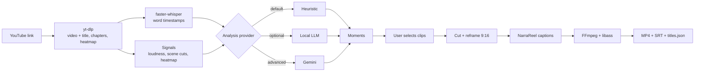

# Snipmint: Plan (strategy and architecture)

| | |
|---|---|
| **Date** | 2026-11-05 |
| **Related** | [PRD.md](PRD.md) (what and why) · [IMPLEMENTATION.md](IMPLEMENTATION.md) (step-by-step build) |

**In one line:** the user pastes a YouTube link and gets vertical shorts with NarraReel captions.
- **Look:** NarraReel's UI and caption engine.
- **Engine:** OpenShorts' download, analysis and reframing.
- **AI:** free by default; Gemini is the optional Advanced mode.
- **Delivery:** Docker.

---

## 1. Source repos at a glance

| | **OpenShorts** (mutonby/openshorts) | **NarraReel** (SanTiwari07/NarraReel) |
|---|---|---|
| What it does | Long video → many short clips | Written script → one narrated captioned video |
| Backend | FastAPI. `app.py` (8.4k lines, mixed with cloud/billing/SEO) + `main.py` (2.7k lines, one process per job) | FastAPI `server/app.py` (640 lines), clean package, thread job runner with SSE events |
| Frontend | React JSX dashboard + SaaS pages | React 19 + TypeScript + Vite + Zustand + React Router, one question per screen |
| Strengths | yt-dlp download, Whisper word timestamps, scene detection, speaker-tracking reframe, Gemini 2-pass moment picker | 10 caption presets, 19 fonts, ASS/libass render, live phone preview, TTS voices, tests, Docker |
| AI | Gemini is required, unless `LLM_BASE_URL` points at a local LLM | None (no keys) |
| License | MIT. **`cloud/` is commercial, so never copy it** | MIT |

Without a key, OpenShorts' `get_viral_clips()` returns `None` and the job fails. The new **heuristic analyser** therefore becomes Snipmint's core addition.

## 2. Integration strategy

**Use NarraReel as the base and port selected OpenShorts modules in.**
- Port functions, not the whole of `main.py`/`app.py`, because they're coupled to cloud and env globals.
- Keep both MIT notices in `NOTICE`.

| Ported from OpenShorts | Becomes |
|---|---|
| download logic in `main.py`, `yt_clients.py`, `ssrf_guard.py` | `snipmint/ingest/` |
| `transcribe_backends.py`, parts of `subtitles.py` | `snipmint/transcribe/` |
| `scene_detection.py` | `snipmint/analyze/signals.py` |
| `clip_selection.py` | `snipmint/analyze/windows.py` |
| `gemini_worker.py` schemas and prompts, `main.get_viral_clips` / `_run_gemini_stage` / `get_visual_clips` | `snipmint/analyze/providers/gemini.py` |
| `llm_backend.py` | `snipmint/analyze/providers/local_llm.py` |
| `reframe_v2.py`, `active_speaker.py`, `split_layout.py`, `ffmpeg_utils.py` (+ helpers) | `snipmint/reframe/` |
| `layout_picker.py`, `screencast_layout.py` | `snipmint/reframe/layout_ai.py` (Gemini only) |

**Kept from NarraReel:**
- the frontend shell, theme, stepper and phone frame
- `captions/` and the presets
- `render/ffmpeg_render.py`
- `engines/` (TTS)
- `jobs/`
- `server/`
- the Dockerfile pattern

**Left out:**
- OpenShorts: `cloud/`, billing, auth, SEO, MCP, autopilot, S3, paid proxies, watermark, ElevenLabs, `osrender/` GPU kernels
- NarraReel: the script/length steps; they're replaced by the source/moments steps

**The glue:** `captions/from_transcript.py` converts Whisper words into NarraReel's `ScriptAnalysis` + `WordTiming[]`. All 10 presets then work on real speech.

## 3. Pipeline



## 4. Analysis modes

All providers implement `pick_moments(transcript, signals, meta, opts) -> list[Moment]` and return the same `Moment` schema. The UI and the renderer never branch on the provider.

| | **Free (default)** | **Local AI (optional)** | **Advanced: Gemini** |
|---|---|---|---|
| How | Weighted rules: replay heatmap, chapters, hook phrases, loudness peaks, TF-IDF keywords, sentence boundaries, scene-cut density | OpenShorts score → detail prompts on Ollama / LM Studio | OpenShorts 2-pass prompts with `response_schema`; layout picker on 12 frames; vision path for silent video |
| Titles / hooks | Extracted from the transcript or chapters | Generated | Generated per platform |
| Needs | Nothing | Local model server | `GEMINI_API_KEY` |
| Sends data out | No | No | Transcript text + 12 frames |
| On failure | n/a | Falls back to Free | Falls back to Free, with a UI badge |

**Gemini design rules:**
- Default model `gemini-3.1-flash-lite`.
- Heuristic signals are passed into the prompt as hints.
- The full video is sent only on the silent-video path, behind a length guard (about 300 tokens/s).
- The key comes from env or the `X-Gemini-Key` header, and is never logged or stored.

## 5. Tech stack

| Layer | Choice |
|---|---|
| Frontend | React 19, TypeScript, Vite, React Router, Zustand, plain CSS tokens, Vitest |
| Backend | Python 3.12, FastAPI, Uvicorn, Pydantic v2, sse-starlette, Typer CLI |
| Jobs | NarraReel `JobRunner` (thread + queue, events persisted to the job folder). No Redis |
| Storage | Files on disk under `/data` (sources, jobs, projects as JSON). No database |
| Download | yt-dlp |
| Speech-to-text | faster-whisper (CTranslate2) |
| Video analysis | PySceneDetect, OpenCV, MediaPipe (faces); optional Ultralytics YOLO + PyTorch (GPU) |
| Signals | NumPy (loudness), scikit-learn-free TF-IDF in pure Python |
| AI (optional) | `google-genai` (Gemini); `httpx` to any OpenAI-compatible server |
| Captions / render | ASS subtitles + libass inside FFmpeg; Pillow + fontTools for measuring |
| Voices (optional) | edge-tts, kokoro-onnx, Chatterbox |
| Quality | ruff, pytest, Vitest, GitHub Actions (Linux + Windows) |
| Delivery | Docker (multi-stage image) + docker compose with profiles |

## 6. Docker architecture

```text
docker-compose.yml
├─ snipmint        (default)  CPU image: UI + API on :8000
├─ snipmint-gpu    (profile gpu)    CUDA image: + torch, YOLO, whisper on GPU
└─ ollama          (profile ollama) local LLM for the "Local AI" mode
volumes:
  ./data   → /data           sources, jobs, clips, projects (visible from Windows)
  models   → /models         whisper / kokoro / mediapipe weights (download once)
env: .env  (GEMINI_API_KEY, YOUTUBE_COOKIES_FILE, WHISPER_MODEL, SNIPMINT_TOKEN ...)
```

**Image (multi-stage, based on NarraReel's Dockerfile):**
1. `node:22-slim` builds `frontend/dist`.
2. `python:3.12-slim` with `ffmpeg` (Debian build includes libass), `libgl1`/`libglib2.0-0` for OpenCV, and `espeak-ng` (Kokoro). Then `pip install ".[server,reframe,gemini]"`, copying the frontend build into `snipmint/server/static`.

**Dev workflow:**
- The backend container mounts `./snipmint` and runs `uvicorn --reload` (`docker-compose.dev.yml`).
- The frontend runs on the host with `npm run dev` (Vite proxies `/api` to `:8000`).

**Windows:** needs Docker Desktop + WSL2. The GPU profile also needs an NVIDIA driver with WSL support.

## 7. Repo layout

```text
snipmint/
├─ snipmint/
│  ├─ ingest/        youtube.py, upload.py, guard.py
│  ├─ transcribe/    whisper.py, cache.py
│  ├─ analyze/       signals.py, windows.py, schemas.py, prompts.py, service.py
│  │  └─ providers/  heuristic.py, local_llm.py, gemini.py
│  ├─ reframe/       center.py, track.py, split.py, layout_ai.py, ffmpeg_utils.py
│  ├─ captions/      (NarraReel) + from_transcript.py
│  ├─ engines/       (NarraReel TTS, optional)
│  ├─ render/        (NarraReel) + clip_render.py
│  ├─ pipeline/      source.py, clips.py
│  ├─ jobs/  server/ (NarraReel, extended)
│  └─ presets/  assets/fonts/
├─ frontend/         NarraReel UI + new steps
├─ docker/           Dockerfile, Dockerfile.gpu
├─ docker-compose.yml  docker-compose.dev.yml  .env.example
├─ tests/  NOTICE  LICENSE  pyproject.toml
└─ PRD.md  PLAN.md  IMPLEMENTATION.md
```

## 8. Phases

| Phase | Delivers | PRD milestone |
|---|---|---|
| 0. Scaffold | Repo from NarraReel, renamed; Docker + compose working; CI green | n/a |
| 1. Free MVP | Link → download → whisper → heuristic moments → center crop → captions → MP4. Screens: Start, Source, Moments, Captions, Export | M1 |
| 2. Smart framing | Speaker tracking, split layout, formats, zip download, single-clip re-render | M2 |
| 3. Advanced AI | Gemini provider, key UI, fallback, layout picker, emphasis keywords | M3 |
| 4. Extras | Upload, cookies, local LLM, silent video, ASR cleanup, hook voice-over, project files | M4 |

Step-by-step tasks, file lists and acceptance checks are in [IMPLEMENTATION.md](IMPLEMENTATION.md).

## 9. Risks

| Risk | Mitigation |
|---|---|
| YouTube bot checks | Updatable yt-dlp, cookies file, clear errors. No paid proxy chain |
| License | Never copy `openshorts/cloud/`. Keep the MIT notices |
| Image size and build time | CPU image without torch; GPU extras behind a profile |
| Weak heuristic picks | Heatmap signal, weights tuned on a test set, Gemini upgrade path |
| Gemini video cost | Text + frames only; silent-video path behind a length guard |
| Voice-cloning misuse | Keep NarraReel's consent flow; own voice only |
