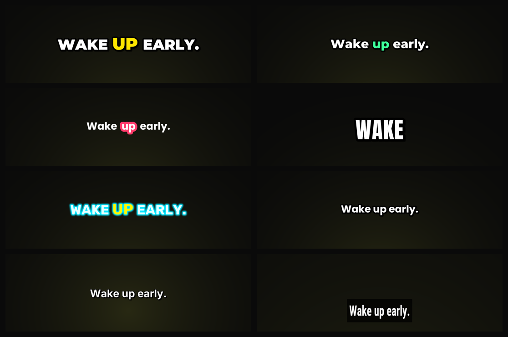

<p align="center">
  
</p>

<h1 align="center">Snipmint</h1>

<h3 align="center">Paste a YouTube link. Get vertical shorts with captions people watch to the end.</h3>

<p align="center">
  Snipmint finds the best moments in a long video, cuts them, crops them to 9:16 around the speaker and adds
  <b>word-by-word animated captions</b>. It runs on your own computer, works with <b>no API key</b>, and gets
  smarter with an optional <b>Gemini key</b>.
</p>

<p align="center">
  <a href="https://github.com/SanTiwari07/Snipmint/actions/workflows/ci.yml"></a>
  
  
  
</p>

<p align="center">
  <a href="#quick-start">Quick start</a> ·
  <a href="#how-to-use-it">How to use it</a> ·
  <a href="#free-or-advanced">Free or Advanced</a> ·
  <a href="#settings">Settings</a> ·
  <a href="#troubleshooting">Troubleshooting</a> ·
  <a href="#development">Development</a>
</p>

---

## What it does

1. **You paste a YouTube link** (or upload a video file from your computer).
2. Snipmint **downloads** the video and **transcribes** every word with its timing (locally, with Whisper).
3. It **finds the best moments** (30-60 s by default) and shows them as cards with a score and a reason.
4. **You pick** the clips you like.
5. Each clip is **cropped to vertical** (9:16): it follows the speaker, stacks two people
   during two-shots, or keeps the whole picture for screen recordings. Black bars are removed.
6. You choose one of **10 caption styles** with a live preview.
7. Optional: an AI voice reads each clip's **hook** over its first seconds.
8. You **download** MP4s (levelled to -14 LUFS), SRT subtitles and suggested titles, and can
   **save the project** to open it again later.

## Free vs Advanced

| | **Free (default)** | **Advanced (your Gemini key)** |
|---|---|---|
| Picks moments with | YouTube "most replayed" data, strong opening lines, loudness, keywords, full sentences | Gemini reads the transcript like an editor: stories, punchlines, payoffs |
| Titles and hooks | Taken from the transcript or chapters | Written for each platform |
| Captions | Whisper's words | Misheard names and terms corrected |
| Videos with little speech | Replay data or evenly spread | Gemini watches the video (up to 45 min) |
| Your data | Stays on your computer | Transcript text (and a few frames) go to Google |
| Cost | Free | A few cents per hour of video |

If Gemini fails (bad key, quota), Snipmint falls back to the free analysis and tells you.

## Quick start

You need [Docker Desktop](https://www.docker.com/products/docker-desktop/) (on Windows, with WSL 2) and about
5 GB of free disk space.

```bash
git clone https://github.com/SanTiwari07/Snipmint.git
cd Snipmint
docker compose up -d --build
docker compose logs snipmint
```

The log shows a link like `http://localhost:8000/?token=…`. Open it in your browser. The link stays the same
from now on, so you can bookmark it.

- The first build takes a few minutes. The first video also downloads the speech model (about 460 MB) once.
- Your videos, clips and the speech model are kept in the `data` folder next to `docker-compose.yml`.
- **Windows, one step:** double-click `start.cmd` (or run `.\start.ps1`). It starts Docker Desktop if needed,
  starts Snipmint (and n8n when it is set up in `.env`), waits until they answer and opens the app with its
  access token. Add `-Build` after an update. `.\stop.ps1` stops everything and keeps all your data.
- Stop with `docker compose down`, start again with `docker compose up -d`.
- To update: `git pull`, then `docker compose up -d --build`.

## How to use it

1. **Start:** paste a YouTube link and press **Find clips**, or **Upload a video**. Choose *Free* or
   *Advanced (Gemini)*.
2. **Video:** Snipmint downloads the video, transcribes it and finds the moments. A 30-minute video takes a
   few minutes on a normal computer.
3. **Moments:** the best three are already ticked. Play any moment, move its start or end by a second, tick
   the ones you want. Change the clip length (15–30, 30–60 or 60–90 s) or the number of clips and press
   **Find moments again**.
4. **Captions:** pick the format (Reels 9:16, square, portrait or YouTube 16:9), a caption style and a font.
   The phone on the right shows a real frame of your clip.
5. **Make clips:** choose the framing (*Auto* is right for most videos), the quality and the optional
   voice-over, then press **Make clips**. Watch the results, then **Download** each clip or **Download all**
   as a zip. **Save project** keeps everything for later.

## Free or Advanced

| | **Free** (default) | **Advanced** (your Gemini key) |
|---|---|---|
| Picks moments with | Replay data, strong opening lines, energy, keywords, full sentences | Gemini reads the transcript like an editor: stories, punchlines, payoffs |
| Titles and hooks | Taken from the transcript or chapter titles | Written for each platform |
| Captions | Whisper's words | Misheard names and terms corrected |
| Videos with little speech | Replay data, or spread evenly | Gemini watches the video (up to 45 minutes) |
| What leaves your computer | Nothing (only the YouTube download) | The transcript text, or a small copy of a silent video |
| Cost | Free | A few cents per hour of video, on your key |

If Gemini fails (wrong key, no quota, a network error), Snipmint uses the free analysis for that video and
says so on screen.

### Turning on Advanced mode

The key goes in a `.env` file on your computer. The app never asks for it in the browser.

1. Get a key at [aistudio.google.com/apikey](https://aistudio.google.com/apikey).
2. In the Snipmint folder, copy `.env.example` to `.env` and set `GEMINI_API_KEY=your-key`.
3. Restart: `docker compose up -d`.
4. In the app choose **Advanced (Gemini)** and press **Check key**.

## Settings

All settings are optional and go in `.env` (see [.env.example](.env.example)). Restart with
`docker compose up -d` after changing them.

| Setting | Default | What it does |
|---|---|---|
| `GEMINI_API_KEY` | empty | Turns on Advanced mode |
| `GEMINI_MODEL` | `gemini-3.1-flash-lite` | Gemini model to use (can also be set in the app) |
| `GEMINI_VIDEO_MAX_MINUTES` | `45` | Longest silent video Gemini will watch |
| `LLM_BASE_URL`, `LLM_MODEL` | empty | Use a local AI server instead (Ollama, LM Studio) |
| `WHISPER_MODEL` | `small` (GPU image: `large-v3-turbo`) | Speech model; `base` is faster, `medium` more accurate |
| `YOUTUBE_COOKIES_FILE` | empty | Cookies file for videos YouTube won't download without sign-in |
| `MAX_SOURCE_MINUTES` | `180` | Longest video accepted |
| `SNIPMINT_DELETE_SOURCE` | `1` | Delete the downloaded video after the clips are made (clips, transcript and analysis stay; a link is downloaded again if you make clips again, an uploaded file must be uploaded again). `0` keeps it |
| `MAX_UPLOAD_MB` | `4096` | Largest file you can upload |
| `SNIPMINT_TOKEN` | made once, kept in `data/.token` | The access token in the link |

**NVIDIA GPU:** `docker compose --profile gpu up -d --build snipmint-gpu` (stop the CPU one first; both use
port 8000). Transcription becomes several times faster.

**Local AI with Ollama:** `docker compose --profile ollama up -d`, pull a model
(`docker compose exec ollama ollama pull qwen2.5:14b`) and set `LLM_BASE_URL=http://ollama:11434/v1`.

## Where your files are

```text
data/
├─ sources/   one folder per video: the download, transcript, analysis and framing
├─ jobs/      one folder per "Make clips": clip_01.mp4, clip_01.srt, titles.json, clips.zip
├─ models/    the speech and face-detection models (downloaded once)
└─ .token     the access token for your link
```

Delete a folder in `sources/` or `jobs/` to free space; Snipmint makes it again when needed.

## Troubleshooting

| Problem | What to do |
|---|---|
| The page says it needs an access link | Run `docker compose logs snipmint` and open the link it prints |
| "YouTube asked for a sign-in check" | Export cookies from a signed-in browser (Netscape format) to `data/cookies.txt` and set `YOUTUBE_COOKIES_FILE=/data/cookies.txt` |
| Port 8000 is already in use | Stop the other program, or change `"8000:8000"` to `"8080:8000"` in `docker-compose.yml` and use port 8080 |
| Transcription is slow | Set `WHISPER_MODEL=base`, or use the GPU image |
| A clip's framing looks wrong | On **Make clips**, choose another framing (*Follow speaker*, *Two people*, *Whole picture* or *Centre*) and make it again |
| Advanced mode says "Used the free analysis" | Press **Check key**; check the key and its quota in Google AI Studio |

## Publish to YouTube (optional)

Snipmint can upload the clips it made to your YouTube channel as Shorts. It is **off** until you
add Google OAuth credentials; everything else works the same without them.

**What you get:** connect/disconnect a channel, per-clip metadata (title with 3 ideas and why one
was picked, description, 3-5 hashtags, tags, hook, pinned comment, category, SEO keywords) in
English, Hindi, Hinglish, Marathi and more, an editor (regenerate, edit or copy any field), batch
publishing with a confirmation step and a live dashboard, and scheduled publishing.

### 1. Set up Google Cloud (once, about 10 minutes)

1. Open the [Google Cloud console](https://console.cloud.google.com/) and **create a project**
   (for example "Snipmint").
2. **APIs & Services → Library**: search for **YouTube Data API v3** and click **Enable**.
3. **APIs & Services → OAuth consent screen** (Google Auth Platform → Branding/Audience):
   - User type **External**, app name "Snipmint", your e-mail as support and developer contact.
   - **Data access / scopes**: add `.../auth/youtube.upload` and `.../auth/youtube.readonly`.
   - **Audience → Test users**: add the Google account that owns your channel.
   - **Testing mode warning:** while an *External* app's publishing status is *Testing*, only test
     users can sign in and Google expires the refresh token after **7 days**. Snipmint then asks you to
     connect again. Publish the app (Audience → *Publish app*) to avoid this; Google may ask for
     verification of the YouTube scopes before you can.
4. **APIs & Services → Credentials → Create credentials → OAuth client ID**, type **Web application**.
   Use **two clients**, one per environment, so development never touches production settings:

   | Client | Authorized redirect URI |
   |---|---|
   | *Snipmint (development)* | `http://localhost:8000/api/youtube/oauth/callback` |
   | *Snipmint (production)* | `https://<your-host>/api/youtube/oauth/callback`, or for a Docker install used only on this computer `http://localhost:8000/api/youtube/oauth/callback` |

   Google only accepts plain `http` for `localhost` / loopback addresses; anything public must be
   `https`. Snipmint checks this at start-up and shows the problem on the Publish screen.
   Google compares the URI exactly, so also add `http://127.0.0.1:8000/...` if you open Snipmint that way.

### 2. Local development (no deployment needed)

```bash
cp .env.development.example .env.development   # fill in the development client
snipmint serve --dev                           # API on :8000, reads .env.development
cd frontend && npm run dev                     # UI on :5173
```

`.env.development` is read only by `snipmint serve --dev` (or `--env-file <file>`) and by
`docker-compose.dev.yml`. In `--dev` mode an empty `GOOGLE_REDIRECT_URI` means
`http://localhost:<SNIPMINT_PORT>/api/youtube/oauth/callback`, and after signing in you land back on
the Vite UI (`SNIPMINT_UI_URL`, default `http://localhost:5173` in dev). Open the UI at
`http://localhost`, not `127.0.0.1`, so the sign-in cookie matches the callback host (the Publish
screen warns you when they differ).

### 3. Production / Docker

Put the **production** client in `.env` (copied from `.env.example`); `docker compose up --build`
reads only that file:

```env
GOOGLE_CLIENT_ID=1234-abc.apps.googleusercontent.com
GOOGLE_CLIENT_SECRET=GOCSPX-...
GOOGLE_REDIRECT_URI=https://clips.example.com/api/youtube/oauth/callback
SNIPMINT_SECRET_KEY=<a long random string>   # encrypts the stored sign-in
SNIPMINT_TOKEN=<a long random string>        # required when Snipmint is reachable from the network
```

For a Docker install used on the same computer, `GOOGLE_REDIRECT_URI=http://localhost:8000/api/youtube/oauth/callback`
is fine; open Snipmint at `http://localhost:8000`. The encrypted sign-in lives in
`./data/integrations/` (never in project files, job folders or exports). Set `SNIPMINT_SECRET_KEY` so
the key isn't stored next to the data. Restart Snipmint, make some clips, then click
**Publish to YouTube** on the *Make clips* screen.

### 4. Limits you should know

- **Visibility:** pick *Public*, *Unlisted* or *Private*; Snipmint sends exactly that as
  `status.privacyStatus`. Since the YouTube Data API revision of 2 November 2026, uploads from
  unverified API projects are no longer forced to private. If YouTube still sets a different
  visibility (for example a channel default or a policy review), the dashboard says so instead of
  claiming the one you asked for.
- **Quota:** `videos.insert` has its own *Video Uploads* quota bucket. The default is
  **100 upload calls a day** per Google Cloud project, but quotas are project-specific: check yours
  under *Google Cloud console → APIs & Services → YouTube Data API v3 → Quotas* and request more
  there. Hitting the limit shows a clear error; retry after midnight Pacific time.
- **Scheduling** uploads the clip right away as *private* with a publish time (`status.publishAt`,
  which YouTube only accepts on private videos); YouTube makes it public at that time even if
  Snipmint is off. Scheduled items can be cancelled in Snipmint until their upload finishes; after
  that, change or cancel the schedule in YouTube Studio (Snipmint only has upload permission, not
  permission to edit videos).
- Uploads are resumable: a network hiccup is retried with exponential backoff, and uploads a restart
  interrupted continue on the next start. The same clip file can't be sent to the same channel twice
  unless you tick *Upload again anyway*.
- Metadata is written only from the clip's transcript. Without a Gemini key a free builder uses the
  speaker's own sentences (it can't translate); with a key, Gemini writes it in the language you pick.
- Follow the [YouTube API Services Terms](https://developers.google.com/youtube/terms/api-services-terms-of-service)
  and Google's OAuth policies: only publish videos you have the rights to.

### Security

The sign-in uses the OAuth authorization-code flow on the server with PKCE and a single-use `state`
bound to your browser. Tokens are encrypted at rest (Fernet), never sent to the web app, never written
to logs, projects or exports, and **Disconnect** revokes them at Google. Snipmint asks only for
`youtube.upload` and `youtube.readonly`.

## Workflow automation with n8n (optional)

[n8n](https://n8n.io) can run Snipmint's publishing for you: publish approved clips as soon as
they are made, at a set time, or in batches with a delay between uploads, and send you a Telegram,
Discord or e-mail message about the result. Snipmint stays in charge: metadata, **your approval**,
the YouTube sign-in and every upload happen in Snipmint; n8n only decides *when* to ask for them,
using a shared secret. Nothing changes if you don't use it.

```text
 Snipmint web app ──> Snipmint API (source of truth) ──signed events──> n8n
                        ▲   │ metadata, approval, OAuth,                │ schedules, batches,
                        │   │ uploads, status                           │ retries, notifications
                        │   ▼                                           │
                        │  YouTube Data API                             │
                        └────────── /api/integrations/n8n/* (shared secret) ┘
```

Quick start: set `SNIPMINT_N8N_WEBHOOK_SECRET`, `N8N_ENCRYPTION_KEY` and `N8N_DB_PASSWORD` in `.env`, run
`docker compose -f docker-compose.yml -f docker-compose.n8n.yml up -d`, open n8n on
`http://localhost:5678`, import the files in [`workflows/n8n/`](workflows/n8n/), then turn
**Automation** on in Snipmint's Publish screen. The full guide (credentials, each workflow, monitoring
and recovery) is [docs/n8n.md](docs/n8n.md).

## Development

Snipmint is a Python package (FastAPI, ffmpeg, faster-whisper, OpenCV) with a React + TypeScript web app.

```bash
python -m venv .venv
. .venv/bin/activate                          # Windows: .venv\Scripts\activate
pip install -e ".[dev,server,transcribe,scenes,reframe,gemini]"
snipmint serve --dev                          # API on http://localhost:8000

cd frontend
npm install
npm run dev                                   # web app on http://localhost:5173
```

You also need ffmpeg with libass on your PATH (`winget install Gyan.FFmpeg`, `brew install ffmpeg` or
`sudo apt install ffmpeg`).

Checks (the same ones CI runs):

```bash
python -m venv .venv && . .venv/bin/activate     # Windows: .venv\Scripts\activate
pip install -e ".[dev,server,transcribe]"
snipmint serve --dev                             # API on :8000

cd frontend && npm install && npm run dev        # UI on :5173
```

Tests: `pytest -m "not network and not models"` and `cd frontend && npm test`.

## Caption styles

<p align="center">
  
</p>

More about the styles in [docs/captions.md](docs/captions.md).

## Credits

Snipmint is built on two MIT-licensed projects:

- **[NarraReel](https://github.com/SanTiwari07/NarraReel)**: the web app, caption engine and presets, renderer,
  voices and job runner.
- **[OpenShorts](https://github.com/mutonby/openshorts)**: ideas and code for downloading, clip selection,
  reframing and the Gemini prompts (core only; nothing from its commercial `cloud/` folder).

Face detection uses OpenCV's YuNet model. See [NOTICE](NOTICE) and
[THIRD_PARTY_LICENSES.md](THIRD_PARTY_LICENSES.md).

## Responsible use

Only clip videos you own or have permission to use. Many platforms require you to label AI-generated content;
check the rules of the platform you post on. Clone only your own voice.

## Licence

[MIT](LICENSE)
