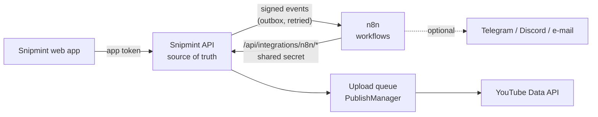

# Workflow automation with n8n

n8n is optional. It lets Snipmint publish approved clips without you pressing the button: as soon
as they are approved, at a set time, or as a batch with a pause between uploads, and it can tell you
what happened on Telegram, Discord or by e-mail. Snipmint works exactly the same without it.

## How it fits together



| Snipmint keeps | n8n does |
|---|---|
| Clips, metadata (Gemini or the free builder), **your approval** | Decides *when* to ask Snipmint to publish |
| The YouTube sign-in (encrypted, never leaves Snipmint) | Polls for scheduled and retry-ready work every minute |
| Every upload (resumable, duplicate-proof) and its status | Runs batches one clip at a time with a delay |
| Schedules, retries (backoff + attempt limit), history | Sends notifications |

**What n8n can and can't do.** It holds one shared secret (`SNIPMINT_N8N_WEBHOOK_SECRET`) that
opens only `/api/integrations/n8n/*`. It never sees Google credentials, YouTube tokens, the Gemini
key or `SNIPMINT_TOKEN`. It cannot change metadata or approve anything. Asking Snipmint to publish
something that isn't approved, isn't due, is already uploading, or was already published does
nothing. Asking twice uploads once.

## 1. Start n8n

Add these to `.env` (generate each with `python -c "import secrets; print(secrets.token_urlsafe(32))"`):

```env
SNIPMINT_N8N_WEBHOOK_SECRET=<secret shared by Snipmint and n8n, 24+ characters>
N8N_ENCRYPTION_KEY=<keep it: n8n encrypts its saved credentials with it>
N8N_DB_PASSWORD=<password for n8n's PostgreSQL>
N8N_TIMEZONE=Asia/Kolkata          # your time zone, for n8n's schedules and logs
```

Then start Snipmint, n8n and n8n's PostgreSQL together:

```bash
docker compose -f docker-compose.yml -f docker-compose.n8n.yml up -d
```

- n8n opens at `http://localhost:5678` (only on this computer). The first visit asks you to create
  the owner account (e-mail + password) that protects the editor. n8n 1.0 and later ignore the old
  `N8N_BASIC_AUTH_*` variables.
- n8n stores workflows and execution history in PostgreSQL (volume `n8n_postgres`) and its settings
  in the `n8n_data` volume. Both survive restarts and upgrades.
- The override sets `N8N_WEBHOOK_URL=http://n8n:5678/webhook` for Snipmint, so Snipmint knows where
  to send events. Without Docker, set `N8N_WEBHOOK_URL` yourself (e.g. `http://localhost:5678/webhook`).
- The image is pinned to `docker.n8n.io/n8nio/n8n:2.46.6`. Override it with `N8N_VERSION`.
- To reach n8n from elsewhere, put an https reverse proxy in front of it and set
  `N8N_PROTOCOL=https`, `N8N_HOST`, `N8N_PUBLIC_URL` and `N8N_SECURE_COOKIE=true`.

## 2. Create the two credentials in n8n

In n8n go to **Credentials → Add credential → Header Auth** and create both:

| Name (exactly) | Header name | Value | Used by |
|---|---|---|---|
| `Snipmint API` | `X-Snipmint-Secret` | your `SNIPMINT_N8N_WEBHOOK_SECRET` | HTTP Request nodes that call Snipmint |
| `Snipmint webhook` | `X-Snipmint-Secret` | the same secret | Webhook nodes that receive Snipmint's events |

Optional, for notifications: a **Telegram** credential (bot token), a **Discord Webhook**
credential, and/or an **SMTP** credential.

## 3. Import the workflows

The files are in [`workflows/n8n/`](../workflows/n8n/) (also mounted read-only at `/workflows` in
the container). Import them in the editor (**Workflows → Import from file**), or all at once:

```bash
docker compose -f docker-compose.yml -f docker-compose.n8n.yml exec n8n n8n import:workflow --separate --input=/workflows
```

| File | Trigger | What it does |
|---|---|---|
| `automated-publishing.json` | Webhook `snipmint/clip-ready` | **A.** Fetch the task (clip + metadata + approval). If approved: publish (with an idempotency key), check every 30 s until it finishes, record the result. If not: mark it *waiting for approval* and stop |
| `scheduled-publishing.json` | Every minute | **B.** Ask Snipmint what is due: schedules whose time has come, failed uploads whose backoff is over, tasks n8n missed while it was down, and tasks approved since they were held. Publish each, independently |
| `batch-publishing.json` | Webhook `snipmint/batch` | **C.** Publish a batch `concurrency` clips at a time with `delay_seconds` between them. A failure doesn't stop the rest. Waits until every clip has an outcome, then records the summary (published / failed / pending / skipped) |
| `metadata-approval.json` | Webhook `snipmint/metadata` | **D.** Write missing metadata with Snipmint's own generator (Gemini if the server has a key, otherwise the free builder) in the task's language (English, Hindi, Hinglish, Marathi, …). Publish only if it is approved |
| `publishing-notifications.json` | Webhook `snipmint/notify` | **E.** Turn events into a message: upload succeeded, upload failed, scheduled upload started, batch completed, metadata waiting for approval |
| `error-handling.json` | Error Trigger | Records a failed n8n execution in Snipmint (shown on the Publish screen) and can alert you |

After importing:

1. Open each workflow and select the credentials (`Snipmint API` on HTTP Request nodes,
   `Snipmint webhook` on Webhook nodes) if n8n didn't match them by name.
2. In `publishing-notifications` and `error-handling`, enable the Telegram, Discord or Email node
   you want. They ship disabled, with no credentials. Fill in your chat id or addresses.
3. In each workflow's **Settings → Error workflow**, choose **Snipmint: error handling**.
4. **Activate** every workflow (toggle at the top right). Inactive workflows don't receive
   events: Snipmint then shows "n8n answered 404" in *Automation activity* and keeps retrying.

The workflows call `http://snipmint:8000` (the Docker service). If Snipmint runs somewhere else,
change the URL in the HTTP Request nodes, or edit `API` in `scripts/build_n8n_workflows.py` and
run it again.

## 4. Turn automation on in Snipmint

Restart Snipmint after setting `SNIPMINT_N8N_WEBHOOK_SECRET`. On the **Publish** screen:

1. **Automation with n8n** shows *n8n connected* when Snipmint can reach n8n.
2. Switch **Automation on**. While it's off, n8n can't start any upload, and scheduled clips wait.
3. Write the metadata, check it, and press **Approve** for each clip. Any later edit or
   regeneration withdraws the approval, so only text you approved is published.
   **Approve metadata automatically** exists but is off by default.
4. Pick clips and **Hand them to automation**:
   - **As soon as approved**: approved clips upload right away; the others wait for you.
   - **At a time**: your local time is converted to UTC and stored in Snipmint. n8n starts the upload
     within a minute of that time. Clips more than `max_lateness_minutes` (default 6 h) late are skipped,
     not published at a surprising time.
   - **As a batch**: with seconds between uploads and how many at once.

Visibility (public, unlisted or private) and *made for kids* come from the choices above the panel.

> Two kinds of scheduling exist. **Schedule** in the manual publish section uploads now as private
> and lets YouTube publish at the time (`publishAt`). **At a time** in automation waits and uploads
> at the time, so you can still edit, re-approve or cancel until then.

## 5. Monitor and recover

- **Snipmint → Publish → Automation activity** shows every task: *Waiting for approval, Scheduled,
  Processing, Uploading, Published, Failed, Cancelled, Skipped*, attempts, next retry time and
  errors, with **Retry**, **Cancel** and **Reschedule**. **Recent n8n runs** lists what the
  workflows reported, including failures from the error workflow.
- **n8n → Executions** has the step-by-step run history (kept 14 days).
- **Failed uploads**: Snipmint retries temporary failures (network, timeouts, YouTube 5xx) after 1, 2,
  4 … minutes (capped at 1 h), up to `max_attempts` (default 4). The scheduled workflow picks them up.
  Permanent failures (quota used up, video rejected, signed out, clip file gone) are not retried.
  **Retry** on the task starts a fresh attempt budget, and a retry resumes the same YouTube upload
  when it can.
- **n8n was down**: Snipmint keeps its events in an outbox and redelivers them with backoff for up to
  10 tries. *Send again* re-queues any that gave up. Work that n8n never heard about is offered again
  by the every-minute poll, because Snipmint stores every task and schedule.
- **Snipmint was down**: on restart it resumes interrupted uploads. n8n's HTTP nodes retry 3 times,
  then the error workflow records the failure; the next poll catches up.
- **Duplicates**: publishing is idempotent (`Idempotency-Key`, plus one upload per task, plus
  Snipmint's duplicate check on the clip file per channel). A redelivered event or a retried n8n
  run cannot upload a clip twice.

## API used by n8n

All under `/api/integrations/n8n`, with header `X-Snipmint-Secret: <secret>`. Alternatively, sign
requests with `X-Snipmint-Timestamp` and `X-Snipmint-Signature: sha256=HMAC_SHA256(secret, "{timestamp}.{body}")`;
signatures older than 5 minutes are rejected. Rate limit: 120 requests a minute per client
(`SNIPMINT_N8N_RATE_PER_MINUTE`). Errors look like `{"error", "type", "details"}`. Send
`Idempotency-Key` on POSTs: a repeat returns the stored answer with `Idempotent-Replay: true`.

| Method | Path | Does |
|---|---|---|
| GET | `/health` | `{ok, version, automation_enabled, youtube_configured}` |
| GET | `/tasks/due?limit=25` | Tasks to publish now (see workflow B) |
| GET | `/tasks/{id}` | Task + clip + metadata + `approved` |
| POST | `/tasks/{id}/publish` | `{execution_id?}` → task + `outcome`: `started`, `awaiting_approval`, `not_due`, `retry_later`, `no_more_retries`, `already_started`, `already_published`, `duplicate`, `skipped`, `missed`, `failed`, `automation_off` |
| POST | `/tasks/{id}/hold` | Mark *waiting for approval* unless approved |
| POST | `/tasks/{id}/metadata` | `{language?, execution_id?}` write missing metadata, then hold or (auto-)approve |
| GET | `/batches/{id}` | Batch, its tasks and `summary` |
| POST | `/executions` | `{execution_id, workflow, status, task_id?, batch_id?, message?}` record a run |

Events Snipmint sends (POST, JSON `{id, type, created, data}`, headers `X-Snipmint-Event`,
`X-Snipmint-Delivery`, `X-Snipmint-Timestamp`, `X-Snipmint-Signature`, `X-Snipmint-Secret`):

| Event | Webhook path |
|---|---|
| `clip.ready` | `snipmint/clip-ready` |
| `batch.created` | `snipmint/batch` |
| `metadata.requested` | `snipmint/metadata` |
| `upload.succeeded`, `upload.failed`, `schedule.triggered`, `batch.completed`, `metadata.awaiting_approval` | `snipmint/notify` |

The web app uses `/api/automation/*` (status, settings, tasks, cancel, retry, reschedule,
executions) with the normal app token.

## Limits

- Tested with mocked n8n and YouTube APIs (see `tests/automation/`). The workflow files are checked
  for structure and against Snipmint's real routes, and imported into n8n 2.46.6 with
  `n8n import:workflow`. Running them end to end inside n8n against a real channel is up to you.
- Automated scheduling resolution is one minute (the poll interval).
- The notification nodes need your own credentials; Snipmint ships none.
- Metadata is written only from the clip's transcript. It aims to be accurate and findable, not to
  promise reach, and adds no trending hashtags unrelated to the clip.
